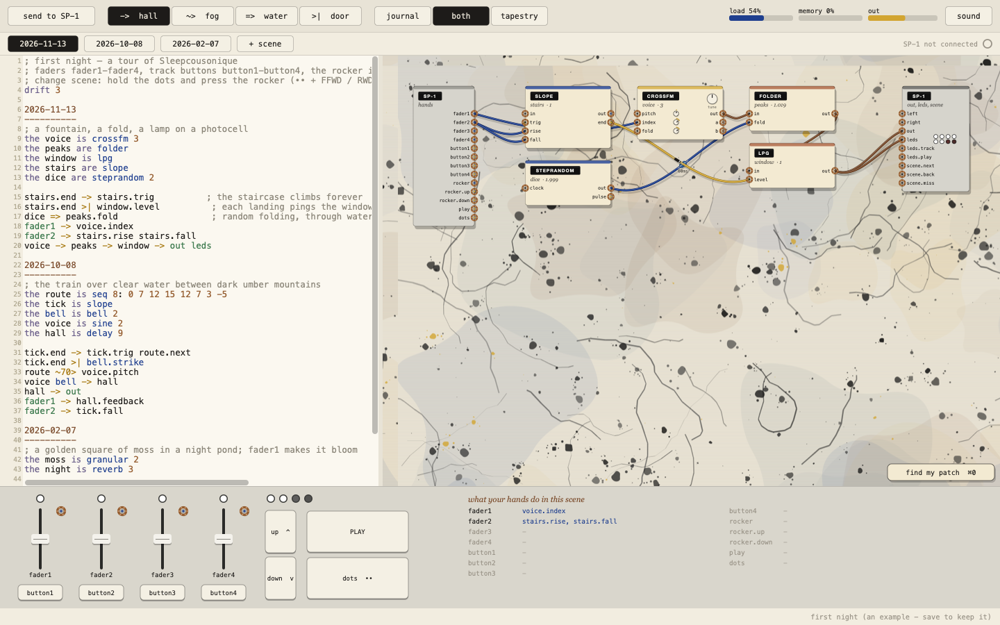
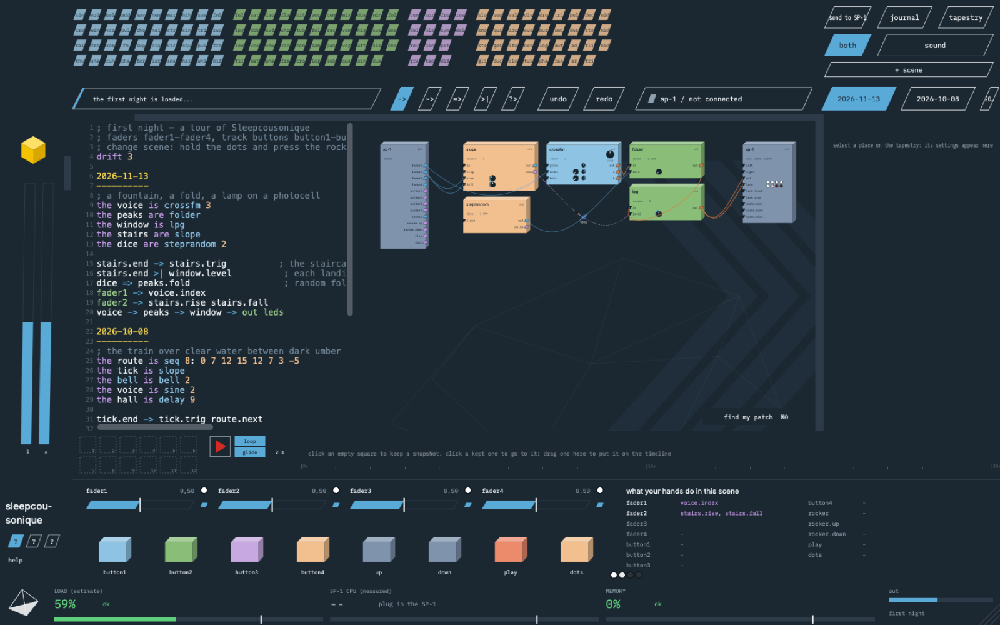
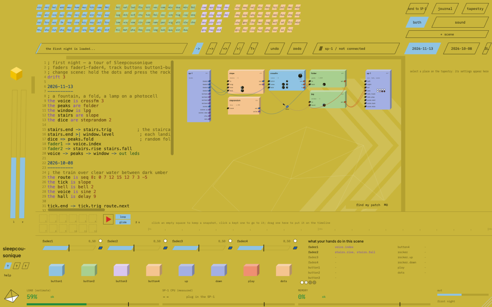
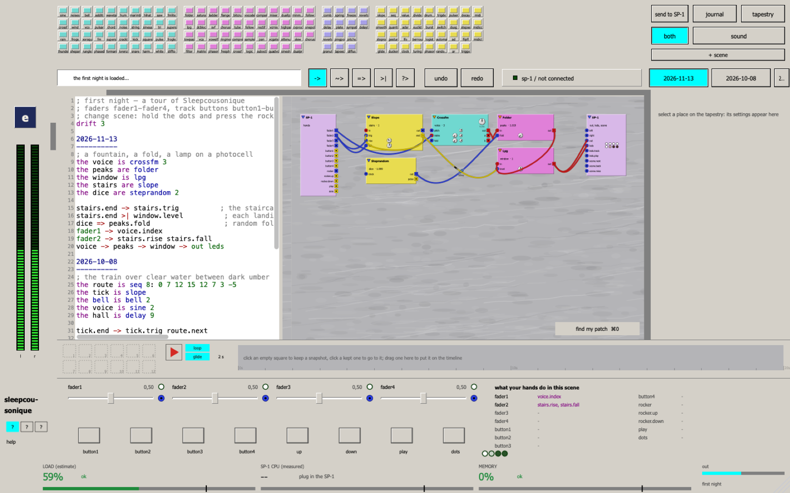
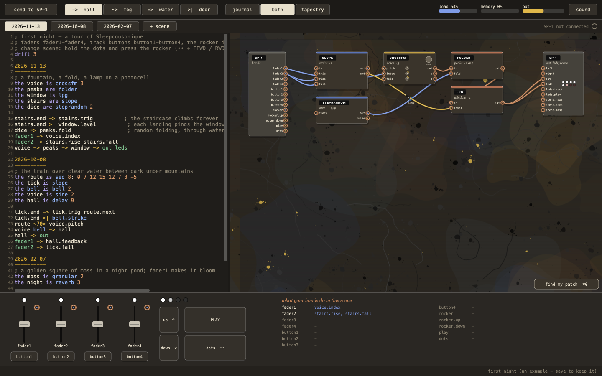

<p align="center"></p>

# sleepcousonique

A dream-journal patch language and modular editor for the Teenage Engineering **SP-1**.
Patch it on the computer, flash the firmware once, then play the patch on the SP-1 alone:
its faders, track buttons, rocker and LEDs do whatever your dream says.



| faltung, dark | faltung, light | modular | journal, dark |
|---|---|---|---|
|  |  |  |  |

**New in 1.4.1:** fixes for sending and installing. After flashing (or plugging it in while off)
the SP-1 waits switched off, and the editor used to say "Flash the firmware first", which sent
people round in circles: it now says the SP-1 is off and to hold ••. Sending no longer freezes the
window, never hangs on an SP-1 that stops reading, and says plainly what's wrong (busy port, other
firmware, older firmware). The Windows editor starts on a PC without the Visual C++ runtime. The
SP-1 firmware is unchanged (1.4.0): no need to reflash.

**New in 1.4.0:** room for bigger patches. The SP-1 plays the same dreams with about a third less of
its processor (the dance scenes measured 91–95 % on 1.2, 51–66 % now, the same sound to the bit),
with 124 KB of memory, 96 places and 320 passages; the load meter is refitted to 390 patches measured
on SP-1s, and ROOM shows whichever limit you are nearest. The firmware has 1.3.0's bell and marimba
fix. (1.3.0 added `crowd` and `visitors`, which hear the Bluetooth devices in the room.)

Write a patch as a dated journal entry, or build it on the tapestry of boards and cords;
every visual edit is a text edit, and every text edit redraws the tapestry. Hear it at once
on the computer, then send it over USB to an SP-1 running the Sleepcousonique firmware.

```
2026-10-08
----------
the route is seq 8: 0 7 12 15 12 7 3 -5
the tick is slope
the voice is sine 2
the hall is delay 9

tick.end -> tick.trig route.next
route ~70> voice.pitch
voice -> hall -> out
fader1 -> hall.feedback
```

- **131 places** from across modular history (Moog, Buchla, Serge, Doepfer, Ciat-Lonbarde,
  Hordijk, the DX7...), bare and lite versions for big patches, `samplerate=` on every one.
- **difference tones** (after Alex Chechile), a **quantizer** with 38 scales plus any Scala
  `.scl` file in your scales folder (La Monte Young, ragas, Carlos, Stockhausen, Riley...).
- **knobs on the modules**: a panel knob on every control input (time, feedback, cutoff, rate...), tune and attenuverters, live while you drag; undo / redo for everything.
- **snapshots and a timeline** (after openprocess): keep what's sounding, cut or glide between snapshots, sequence them.
- **cables**: fat braided audio, thin CV; hanging or routed around the boards like Max, opacity, slack, room light with glow.
- **the room**: `crowd` and `visitors` hear the Bluetooth devices near the computer (how many, how strong, each one coming and going), so a dream changes with whoever is in the room.
- **an honest load meter**: fitted to hundreds of patches measured on SP-1s (`tools/sp1fleet.py`, `tools/calibrate.py`), so what the editor says is what the SP-1 does.
- **looks**: the original journal (default) or openprocess, each light or dark, or following the computer.

Inspired by the dream journal at femishonuga.com, Peter Blasser's **Nabra** (knobless; cords
with parts in them), **Buchla** and **Serge**, and the **Nord Modular** editor.

**[The manual (PDF)](docs/manual/Sleepcousonique-Manual.pdf)** · **[Flashing the SP-1](FLASHING.md)**

## Install

**macOS** (11+, Apple silicon and Intel)

```
brew tap femifleming/tap
brew install --cask femifleming/tap/sleepcousonique
```

or download `sleepcousonique-macOS.zip` from [releases](https://github.com/femifleming/sleepcousonique/releases)
(not notarised: right-click ▸ Open the first time).

**Windows** (10/11, 64-bit): download `sleepcousonique-Windows.zip` from
[releases](https://github.com/femifleming/sleepcousonique/releases), unzip, run `Sleepcousonique.exe`.

Each zip holds the editor, the SP-1 firmware `sleepcousonique-sp1.bin`, the manual,
`FLASHING.txt` and the example dreams.

## Flash the SP-1

Once: turn the SP-1 off, hold **T1 + T4** and plug in USB (boot mode), open
[solderless.engineering](https://solderless.engineering) in Chrome or Edge and flash
`sleepcousonique-sp1.bin`. It restarts switched off (standby, charging): hold **••** for about a
second to turn it on, then send dreams from the editor. Details, troubleshooting and recovery:
[FLASHING.md](FLASHING.md); with an SP-1 in hand, [docs/HARDWARE-CHECK.md](docs/HARDWARE-CHECK.md). The bootloader
is never touched, so T1 + T4 always brings the SP-1 back. Unofficial firmware, not affiliated
with Teenage Engineering.

| folder | what |
|---|---|
| `engine/` | the engine: freestanding C, shared by the editor and the SP-1 |
| `app/` | the desktop editor (JUCE): journal, tapestry, SP-1 hands, sending over USB |
| `firmware/` | the SP-1 firmware: the engine on Wakes' hardware layer (Zephyr 4.3.1) |
| `examples/` | dreams |
| `docs/` | the language, the places, the manual |
| `tools/` | `scqtool` (check / stats / catalog), doc and embed scripts |
| `tests/` | the editor's text-edit tests, the place sweep, and the USB link against a pretend SP-1 (`fakesp1`) |

## Build the editor

```
cmake -B build -G Ninja -DCMAKE_BUILD_TYPE=Release   # fetches JUCE 9.0.5 (or -DFETCHCONTENT_SOURCE_DIR_JUCE=...)
cmake --build build --target Sleepcousonique ScqTests ScqSerialTest fakesp1 scqtool
./build/ScqTests_artefacts/Release/ScqTests
./build/ScqSerialTest_artefacts/Release/ScqSerialTest     # the USB link, against a pretend SP-1
./tools/test_send.sh                                       # the editor's own send, headless (macOS/Linux)
./build/scqtool stats examples/first-night.dream
```

## Build the firmware

See [firmware/README.md](firmware/README.md).

## Licence

MIT (see LICENSE). The firmware's hardware layer is Wakes (Worldwave, MIT); its notices are kept in
`firmware/`.
