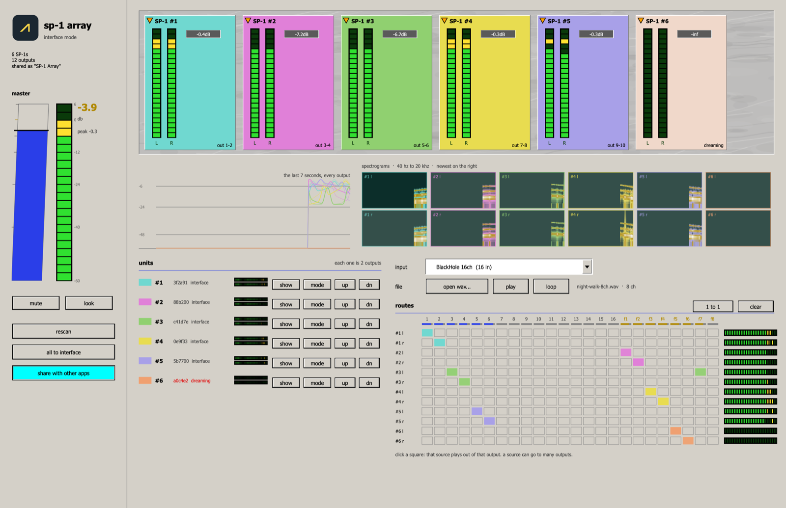

# 3. The SP-1

## Patch here, perform there

This is the Shnth idea. You build a patch in the editor and decide what every fader and
button does by patching it. You send it over USB once, then unplug: the SP-1 runs the patch
on its own, from battery, through its speaker or headphones. Nothing on the device needs the
computer after that. It turns on into the dream it was playing last.

## What runs on it

The Sleepcousonique firmware keeps the hardware layer of **Wakes** (Worldwave's SP-1
firmware, MIT licensed). That layer covers the power-on hold, standby and charging, the
watchdog, the codec start-up order, the fader and button ladders, the LEDs and the USB
device. In place of Wakes' Plaits and Marbles voice it runs the Sleepcousonique engine,
the same C code the editor runs.

## Installing (flashing the .bin)

You flash the firmware once. After that the editor sends your dreams over USB; changing a
patch never needs a reflash.

**Flashing is not sending.** Boot mode (**T1 + T4** held while plugging in) is *only* for
flashing firmware with the Solderless updater in the browser. **send to SP-1** in the editor
never uses boot mode: plug the SP-1 in normally, turn it on with **••**, and send. In boot mode
the editor can't see the SP-1 at all.

You need the SP-1, a USB-C data cable and **Chrome or Edge** (the updater uses WebUSB).

1. Take `sleepcousonique-sp1.bin` from the release zip (or `firmware/dist/`, or build it,
   see *Building*).
2. **Turn the SP-1 off** and unplug it.
3. **Boot mode:** hold **T1 + T4** and plug in USB. Let go when T1 lights.
4. Open **solderless.engineering** in Chrome or Edge, choose the custom firmware (.bin),
   pick `sleepcousonique-sp1.bin`, connect to the SP-1 when the browser asks, and flash.
5. The SP-1 restarts into Sleepcousonique **switched off (standby)**: the USB cable started
   it, so it charges, quietly. That's normal. **Hold ••** for about a second to turn it on: it
   plays the first night, and in the editor the scene bar says **SP-1 connected**, with its slot
   and scene.

That's the last time you need boot mode. The editor doesn't flash anything: only the updater
in the browser does, with the SP-1 in boot mode. **send to SP-1** sends a dream to an SP-1 that
already runs this firmware, plugged in normally (no T1 + T4) and only while it is on. If it is off the scene bar says *SP-1 is off (standby)* and a send tells you to turn it
on; if it runs other firmware the editor says so and asks you to flash it.

On Windows the SP-1 appears as a USB serial (COM) port using Windows' own driver (usbser); on
macOS as `/dev/cu.usbmodem…`. Nothing to install on either; on Windows don't put Zadig/WinUSB on
its serial port, which takes the COM port away. Only one program at a time can hold the port:
quit a serial monitor or a second editor before sending.

This firmware is unofficial: not affiliated with or endorsed by Teenage Engineering.

## If something goes wrong

The bootloader is never touched, so the SP-1 can always be brought back:

1. Turn the SP-1 off and unplug it.
2. Hold **T1 + T4** and plug in USB. Let go when T1 lights: this is boot mode.
3. Flash any `.bin` with the Solderless updater: this one again, a newer one, Wakes,
   the tape looper or anything else.

| part of the SP-1's memory | who writes it |
|---|---|
| 0x00000–0x1FFFF, the bootloader (T1 + T4 lives here) | **never** this firmware |
| 0x20000–0xE6FFF, the firmware | only the bootloader, when you flash a `.bin` |
| 0xE7000–0xFEFFF, the five dream slots | Sleepcousonique, and nothing outside it |
| 0xFF000, the bootloader's settings page | **never** this firmware |

On battery, a crash or unexpected restart turns the SP-1 off instead of looping. Press
**••** to start it again. A dream that misbehaves doesn't need a reflash: send a different
one, or step to another slot with **••** + VOL. Reflashing the firmware may clear the slots,
so keep your `.dream` files on the computer.

## Power and battery

| to | do this |
|---|---|
| turn on | hold **••** for half a second (the track row fills, then it starts) |
| turn off | hold **••** for 1.5 s, touching nothing else |
| check the battery | tap **••**: the play row shows the charge as a bar for 1.5 s |
| see it charging (off) | plug in USB: the play row shows the charge bar, breathing while it charges, solid when full |
| see it charging (on) | plugged in, the play row shows the same charge bar whenever your dream isn't lighting those four LEDs; tapping **••** shows it any time |

The SP-1 charges whenever it's plugged in, from a charger or a computer, on or off. (Wakes
stops charging from a computer while on, to spare battery-powered hosts. Sleepcousonique
keeps charging, because you're usually plugged in to send dreams.) On battery, the SP-1 only
starts when you hold **••**. A crash turns it off rather than looping.

## Bluetooth

Sleepcousonique doesn't send audio over Bluetooth yet. Sound comes out of the speaker and
the headphone jack. The SP-1's Bluetooth is a separate Infineon (Cypress) chip that needs its
own radio program, built with Infineon's SDK, which isn't public, and no released SP-1
firmware sends audio to Bluetooth headphones or speakers so far. Tape Looper's author says
an SP-1 Bluetooth SDK is in development. When it's out, Bluetooth output can be added.

Sleepcousonique never touches the Bluetooth chip. Whatever is on it now stays there, and
flashing back to another firmware brings its Bluetooth back exactly as it was.

The `crowd` and `visitors` places (the Bluetooth devices nearby, section 2) are heard by the
computer's radio, in the editor. On the SP-1 playing alone, `crowd` holds its `rest=` count
and `visitors` is silent.

## Playing it

| SP-1 | Sleepcousonique |
|---|---|
| hold **••** 0.5 s / 1.5 s | on / off (see *Power and battery*) |
| tap **••** | show the battery |
| faders F1–F4 | `fader1`–`fader4` |
| track buttons T1–T4 | `button1`–`button4` |
| FFWD / RWD (the rocker) | `rocker` +1 / −1, `rocker.up` / `rocker.down` pulses, yours to patch |
| **••** + FFWD / RWD | next / previous scene (the track row shows which, 1–4); the rocker doesn't reach `rocker` while •• is held |
| PLAY | `play` |
| **••** | `dots` (while held) |
| VOL + / − | volume |
| **••** + VOL + / − | next / previous dream slot |
| track row LEDs (above T1–T4) | `leds` 1–4 |
| play row LEDs | `leds` 5–8 |

Some things to know:

- The SP-1 reads **one track button at a time**. Its button ladder can't report two held
  together, so don't build a dream that needs chords on the doors.
- Holding a track button sags the rail the faders share, so the faders hold still while a
  button is down. Wakes corrects for this. You'll notice it only as a fader that waits.
- Holding **••** alone for 1.5 seconds turns the SP-1 off. Touching any other control while
  holding it keeps it on, so `dots` gestures with a fader or button are safe.
- Tapping **••** shows the battery on the play row for a moment.

## Dream slots

The SP-1 keeps **five** dreams in its own flash memory, up to 16 KB of text each. **••** +
VOL steps through them. An empty slot plays *first night*. Sending from the editor fills the
slot that is playing. The SP-1 also counts the nights it has been turned on, and `drift` uses
that count, so a dream really does wander from night to night.

Saving a dream pauses the processor for a fraction of a second, so expect a short gap in the
sound when one arrives. Flashing new firmware may wipe the slots, so keep your `.dream`
files.

## Building

You need Zephyr 4.3.1 and the Zephyr SDK 0.17.4, the versions Wakes is pinned to.

```
cd ~/sp1-ws                       # a west workspace with Zephyr v4.3.1 (see firmware/README.md)
west build -p always -b stem_player ~/sleepcousonique/firmware/app \
     -- -DBOARD_ROOT=$HOME/sleepcousonique/firmware
# result: build/zephyr/sleepcousonique-sp1.bin
```

Apply the two patches in `firmware/zephyr-patches/` to the Zephyr tree first, as Wakes
requires (`git apply` inside `zephyr/`).

## Interface mode: the SP-1 as a sound card

Hold **••** + **PLAY** for one second and the SP-1 stops dreaming and becomes a 2-channel USB
sound card (*Sleepcousonique* in your computer's sound settings). Hold them again, or send it
a dream, and it dreams again. The serial command `SCQ MODE IFACE` / `SCQ MODE DREAM` does the
same.

In interface mode the track LEDs show the unit's number in binary (T1 is 1, T2 is 2, T1 + T2 is
3, ...) and the play row shows the level: left by **••**, right by PLAY. The outer two light
when the computer is sending.

**Several SP-1s:** plug them into a powered **multi-TT** USB 2.0 hub and open
*Sleepcousonique Array*. It finds every SP-1, numbers them (#1 is outputs 1–2, #2 is 3–4, ...)
and joins them into one Core Audio device, with a loopback input such as BlackHole if you have
one. Then the grid sends any source to any output:

- **input**: what a DAW plays into the loopback device (BlackHole 16ch: tracks routed to
  outputs 1–16 of BlackHole arrive as inputs 1–16);
- **file**: a multichannel WAV, AIFF or FLAC the Array plays itself (f1, f2, ... are its
  channels);
- **share with other apps** makes the joined device, *SP-1 Array*, visible to your DAW, so it
  can play straight into the SP-1s without the grid.

*show* blinks that unit's LEDs; *up* / *down* change the order (kept by serial number);
*mode* switches one unit between interface and dream. The Array needs the units' serial ports
to number them, so quit the Sleepcousonique editor while you set them up. macOS only for now.

Each output also has a live **spectrogram** (40 Hz to 20 kHz, newest on the right), and the
**master** fader on the left sets the volume of every output at once (double-click: 0 dB).

The **look** button switches the Array between **faltung** (each SP-1 a block on a stage whose
towers rise with its two outputs) and **modular** (each SP-1 a module strip with LED columns on
grey marble, Windows controls).




The SP-1 follows the computer's clock (it resamples by a few hundred parts per million), so
the units stay together. The delay is about 6 ms.

## MIDI in

The SP-1 is also a USB-MIDI device named *Sleepcousonique*. Notes, CCs, pitch bend,
aftertouch and clock reach the dream's `midi`, `midicc` and `midiclock` places (see *MIDI to
CV*). From a computer, send to it from any DAW or MIDI app. For a keyboard or sequencer with
a TRS or DIN MIDI socket, put a **USB-MIDI host adapter** between them: TRS/DIN in, USB-C to
the SP-1, which it also powers. Unplugging lets go of every held note.

## The USB link

The SP-1 shows up as a USB serial port named *Sleepcousonique*. The editor speaks this
protocol to it, which you can also type in a serial terminal:

```
SCQ HELLO                    -> SLEEPCOUSONIQUE 1.5.0
SCQ LOAD <bytes> <slot>      then exactly <bytes> of the .dream text, kept in slot 0-4
                             -> OK 0      or  ERR <why>
SCQ TRY <bytes>              then the text: plays it without keeping it (no slot is written)
SCQ SLOT <1-5>               -> plays that slot
SCQ WATCH 1                  -> about 30 times a second, until WATCH 0 or the port closes:
                                SCQ HANDS f1 f2 f3 f4 buttons scene slot leds
SCQ MEASURE <n>              -> after n blocks: SCQ MEASURED <avg> <max> <budget> <blocks> <dropped> <mem> <total>
SCQ FALLBACK 0|1             -> turn off (1: on) going back to the last dream that fit (for measuring)
SCQ MODE IFACE | DREAM       -> interface mode (a USB sound card) or dreams
SCQ UNIT <n> / WHO / SHOW    -> its number in an array / who are you / flash the LEDs
```

The editor keeps this link open while the SP-1 is plugged in, so its hands panel follows the
SP-1 live, and **send to SP-1** goes over the same connection.

The same port also carries Wakes' diagnostic console (battery, audio load and so on): a
status line every few seconds, `[ON] batt ...` while playing and `[STANDBY] batt ...` while
off. The SCQ commands are only answered while the SP-1 is on.

---

# 4. Credits

- **Peter Blasser**: the Nabra (and *Stores at the Mall*), Shbobo and Fish, whose ideas run
  all through this.
- **Wakes** by Worldwave, MIT licensed: the SP-1 hardware layer this firmware is built on. Its
  licence and notices are in `firmware/LICENSE-wakes`, `firmware/NOTICE` and
  `firmware/LICENSES/`, which also credit the SP-1-dev documentation (Tim Knapen),
  sp1-tape-looper and feldd's sp1-midi, all MIT.
- **Teenage Engineering**: the SP-1.
- Don Buchla, Serge Tcherepnin and Clavia, for the instruments this borrows its thinking
  from.
