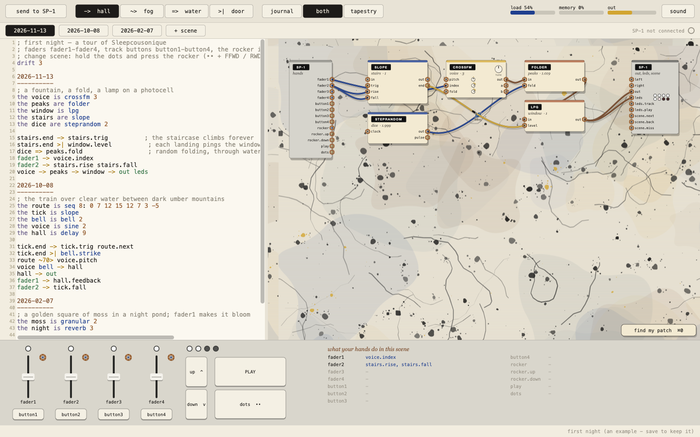
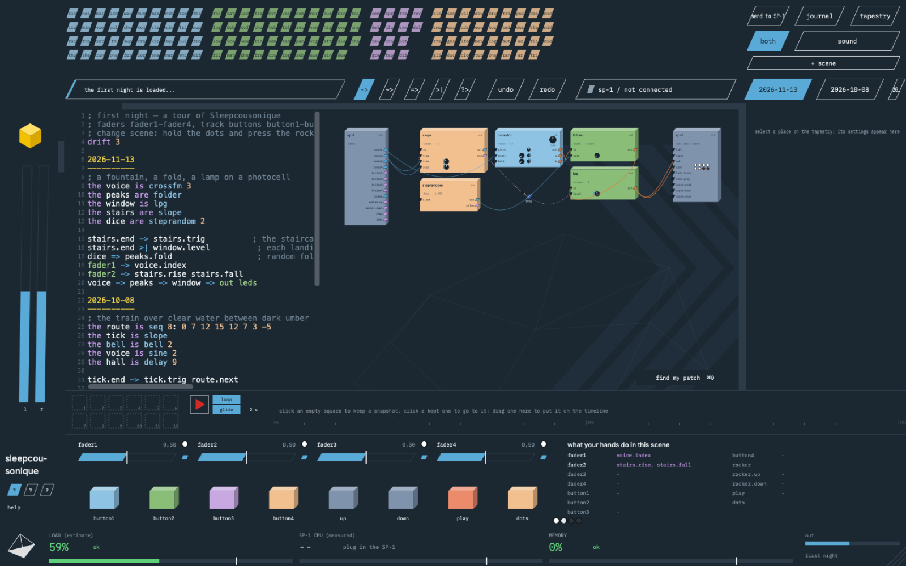
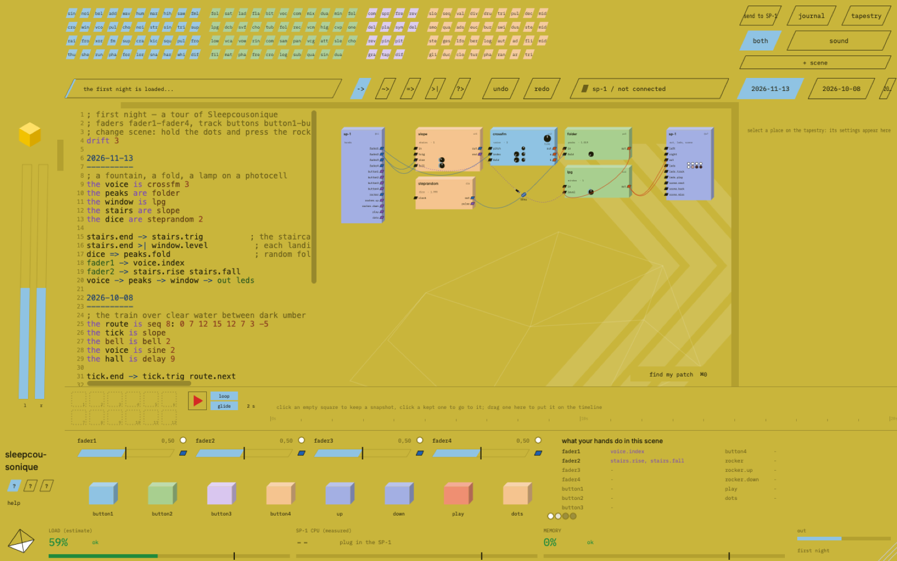
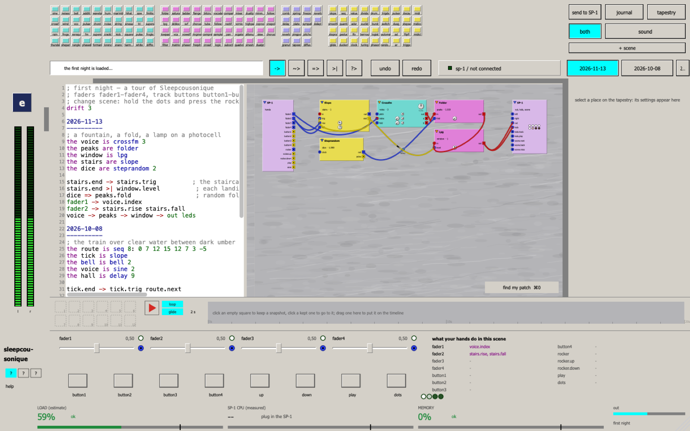
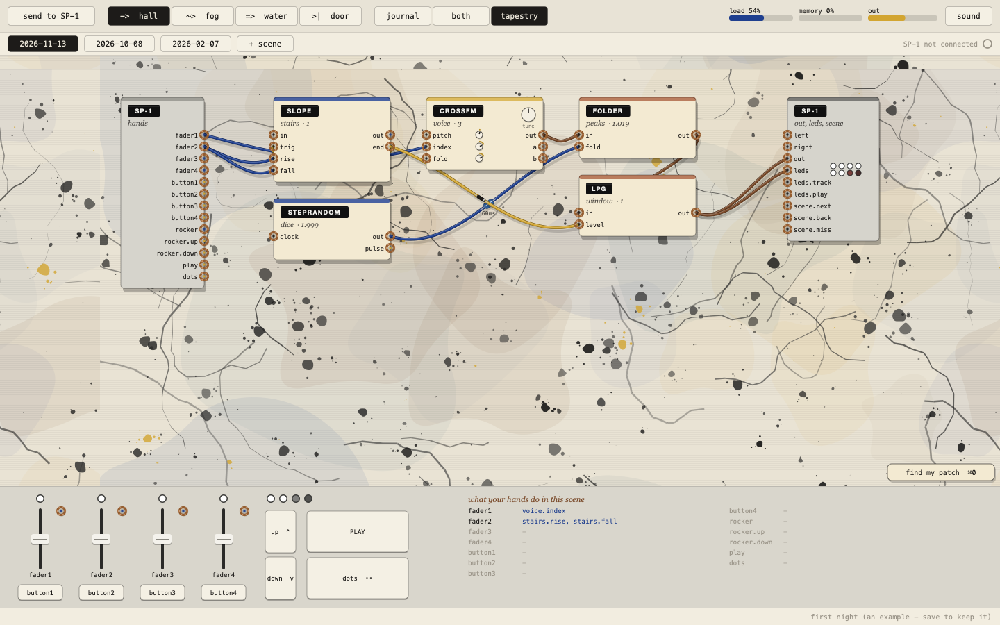

# Sleepcousonique

### A dream-journal patch language for the SP-1

Sleepcousonique is a modular synthesizer you write as a dream journal. Its desktop editor
lets you build a patch as text, as a tapestry of boards and cords, or both at once, and
hear it straight away on your computer. Then you send it over USB to an SP-1 running the
Sleepcousonique firmware, where the faders, buttons, rocker and LEDs play it.

You patch the way you would patch a modular, and decide what each fader and button does by
patching it, the way a Shbobo Shnth is programmed from Fish. Then you take the patch with you
and perform on the SP-1 on its own, with its own audio out.

There are no samples, songs or audio files anywhere in it. Every sound is made live by the
patch, on the computer while you build it and on the SP-1 when you play it. The firmware
doesn't read the SP-1's own storage at all.

It is built from four things:

- **The dream journal** (femishonuga.com/dd.html and the LBSE wiki). Patches are written as
  dated entries. The modules (places) have plain names for what they are: `vco`, `lowpass`,
  `adsr`, `dusg`, `delay`, `quantizer`.
- **Peter Blasser's Nabra**, the knobless tapestry synthesizer. There are no knobs. Every
  place has a fixed nature and maybe a few switches, set in the journal; everything else
  changes only by patching something into it. Cords
  carry parts: a resistor, a capacitor or a diode.
- **Buchla and Serge.** From Buchla come three kinds of signal (sound, current and pulse),
  timbre before filtering, and the lowpass gate. From Serge come any signal into any inlet,
  stacked cords that add, and the universal slope (`slope`, `dusg`).
- **The Nord Modular editor.** You patch on screen and hear it live, with morph groups
  (here, *lucid* groups), a load meter, and patches sent to the hardware.

---

# 1. The editor

## Installing it

| | |
|---|---|
| **macOS** (11 or later, Apple silicon or Intel) | `brew tap femifleming/tap` then `brew install --cask femifleming/tap/sleepcousonique`; or download `sleepcousonique-macOS.zip` from the releases page and drag **Sleepcousonique.app** to Applications |
| **Windows** (10 or 11, 64-bit) | download `sleepcousonique-Windows.zip` from the releases page, unzip it anywhere and run **Sleepcousonique.exe** |

Releases: **github.com/femifleming/sleepcousonique/releases**. Each zip also holds the SP-1
firmware (`sleepcousonique-sp1.bin`), this manual, `FLASHING.txt` and the example dreams.
The macOS app is not notarised: the Homebrew cask clears the download quarantine for you;
from the zip, right-click the app ▸ Open the first time.

## Opening it

Open **Sleepcousonique**. The first time, it opens *first night*, an example dream with
three scenes. `File ▸ Load a history of modular` opens a second example: six scenes, from a
1964 Moog room to 2016 eurorack, each built from the places of its era. Sound comes out of your computer at once. The **sound** button (top right)
picks the audio device.

`File ▸ Open` opens a `.dream` file, and `File ▸ Save` saves one (⌘O, ⌘S). A dream is a plain
text file. You can write it in any text editor, keep it in a notes app, or paste it from
an email.

## Looks

`View ▸ Look` picks how the editor looks: **journal** (the original and the default: splatter
canvas, cream boards, Dymo labels) or **faltung** (the openprocess layout drawn after Mark
Fell's and snd's sleeves and Partials: the place browser along the top as coloured tiles with
codes, a settings column for the selected place, places as folded blocks in their family's
colour, thin coloured cables, slanted controls, a wireframe and chevrons behind the tapestry).
`View ▸ Light or dark` picks **light** (the default), **dark**, or **follow the computer**. In
the faltung look, dark is Partials' blue-grey field and light is a flat mustard sleeve. All of
it is remembered.

The third look, **modular**, is the faltung layout drawn the way the 2004 modular patch
editors were: Windows-grey chrome with raised and sunken edges, a grey marble tapestry, places
as coloured module strips with a triangle and a bold name, round inputs and square outputs
(red for sound, blue for currents, yellow for pulses), fat cables with a dark edge, grey knobs,
cyan "on" buttons, LED meters and Tahoma type. It has one appearance (light or dark doesn't
change it).

In the faltung look, click a tile in the browser grids to put that place on the
tapestry (hover to read what it is). Select a place and its settings appear in the column on
the right: drag a bar (it plays as you drag), double-click to put it back, click a switch to
step it. The undo and redo buttons sit beside the passages; the **?** squares open the
references and the flashing guide.

## Three views

The **journal / both / tapestry** buttons choose what fills the window.

- **Journal.** The dream as plain text. Type here, or paste a whole patch in. About half a
  second after you stop typing, the dream is understood again and the sound follows. If a
  line has a mistake, the last dream that made sense keeps playing, and the mistakes are
  listed under the text. Click a mistake to jump to its line.
- **Tapestry.** The same dream as boards on a splatter-painted canvas, joined by cords.
- **Both.** Side by side. Drag the bar between them to share the space.

The journal and the tapestry are one dream. Whatever you do on the tapestry is written into
the journal, and whatever you write in the journal appears on the tapestry.

## The tapestry

Each **board** is a place. The black label tape names the place, and the italic line under it
gives the board's own name and its nature. Inlets are the copper loops on the left and
outlets the loops on the right. The dot in an outlet's loop shows what kind of signal comes
out: **umber** for sound, **deep blue** for current, **gold** for pulses.

Two grey boards are always there. **SP-1 hands** on the left holds the faders, buttons, rocker,
PLAY and the dots. **SP-1** on the right holds the outputs, the eight LEDs (`leds`, lit live on
the board) and `scene` changes. Right-click a place to set its switches (a DUSG's cycle and
range, a quantizer's scale); the journal line changes with it.

| to | do this |
|---|---|
| add a place | right-click the canvas ▸ sources / shapes / spaces / currents. Each entry says what the place does and, in brackets, what it comes from |
| patch | drag from an outlet to an inlet (or from an inlet back to an outlet) |
| choose the cord's part | the **-> hall / ~> fog / => water / >\| door / ?> maybe** buttons choose the part for new cords |
| remove a cord | option-click it (option-click a loop to pull out every cord there) |
| stack a cord | cmd-drag a cord: a new one leaves from the same outlet (or just drag from the outlet again) |
| see code in the patch | select lines in the journal: their places and cords light up gold in the tapestry |
| lights, cables | View ▸ Room light dims the canvas and boards while cords and LEDs glow; View ▸ Cable opacity, Cable slack (tight to very loose), Cable routing (hanging curves, or around the boards like Max) |
| find my patch | the button at the bottom right, double-click the empty canvas, or cmd-0; right-click ▸ find... jumps to any place |
| undo, redo | cmd-Z, shift-cmd-Z (or the Edit menu): cords, moves, places, switches, knobs and typing, all in one history |
| change a cord | right-click it: change its part, its amount, show it in the journal, or remove it |
| set a cord's amount | double-click it |
| turn a knob | drag a board's **tune** knob (top corner: base pitch, in octaves) or an inlet's **attenuverter** (the little knob by each inlet of a source) up or down; shift for fine steps, double-click to reset. The sound follows as you drag |
| change a kept value | drag a value tag (the little white tag by an inlet) up or down; hold shift for fine steps. The sound follows as you drag |
| move boards | drag them; shift-click to pick several |
| remove | select a board or cord and press delete |
| copy as text | ⌘C copies the selected boards and the cords between them *as journal text* |
| paste text | ⌘V pastes journal text (from anywhere) onto the tapestry, at the mouse. Names that are already used are renamed |
| find in the journal | double-click a board |
| move around | drag the empty canvas or scroll; ⌘-scroll or pinch zooms; ⌘0 fits everything |

Cords come in two kinds, as on a modular. **Audio** leads (from a sound outlet) are fat and
braided and hang a little lower; in the openprocess look, a thick dotted line. **CV** leads are
thin and plain, and **pulses** thin and beaded (dashed in the openprocess look).

Hovering an outlet shows its live value at the bottom of the window, like a probe. Board
positions are kept in the file as notes at the very end, lines starting with `;@`. The engine
ignores them.

## The hands panel: your mappings

Along the bottom is a stand-in for the SP-1:

- **four faders** (`fader1`–`fader4`), each with a copper loop. Drag the loop onto any inlet on
  the tapestry to map that fader there.
- **four track buttons** (`button1`–`button4`), held while the mouse is down.
- **the rocker** (`rocker ^` / `rocker v`), **PLAY** (`play`) and **the dots** (`dots`).
- **the eight LEDs**, showing what `leds` is doing.
- **what your hands do in this scene:** every control, and every inlet the playing scene
  sends it to (for example `fader1  hall.feedback, voice.index`). This is your performance map
  for the SP-1. Click a row to find that mapping in the journal. A dash means the control
  does nothing in this scene.

**With the SP-1 plugged in and on, the panel follows it live.** Its faders move with yours,
its buttons light as you press them, its LEDs show what the SP-1's LEDs show, and **•• +
rocker** on the SP-1 changes the app's scene too. A green **SP-1 live** light shows the
connection. The mouse and keys keep working: a hardware control only takes over when you
move it.

When you are not typing in the journal, the computer keyboard plays the hands. **1–4** are
the doors, **↑ ↓** the rocker, **space** is PLAY and **.** is the dots. **.** + **↑ ↓** changes
scene.

## Snapshots and the timeline

The strip above the SP-1's hands (View ▸ Snapshots and timeline) is for composing, after
openprocess. A **snapshot** keeps what's sounding: every cord amount and kept value, every
tune, attenuverter and param, the four faders, and the scene, by name, so it still works
after you edit the dream.

| to | do this |
|---|---|
| keep a snapshot | click an empty square (shift-click a kept one to keep it again; option-click clears it) |
| go to it | click it: **cut** jumps there, **glide** gets there smoothly over the time beside it (click the time to change it: 0.5 to 30 s) |
| put it on the timeline | drag its square onto the lane |
| set a segment's length | drag its right edge (half seconds) or right-click ▸ length |
| cut or glide | right-click a segment: **cut** holds its snapshot, **glide** morphs from it into the next one over its length (the white ramp) |
| play | the red flag (or space with the strip selected); **loop** goes round again; click the lane to move the playhead |
| remove a segment | select it and press delete, or right-click ▸ remove |

Everything the timeline plays goes the same way as your own knobs, to the sound here. Snapshots and the timeline are kept in the dream as
`;~snap` and `;~timeline` lines at the end, which the engine ignores; undo covers them.

## Scenes

Every dated heading in the journal is a scene, and each scene is its own patch. The scene
buttons under the toolbar switch between them. On the SP-1, and on the hands panel, hold the
dots and press the rocker (**•• + FFWD / RWD**, or `.` + ↑ / ↓ on the keyboard). The rocker on
its own is always `rocker`, free to patch. **+ scene** adds today's date as a new scene. A
patch can also change scene by itself: anything sent into `scene.next` or `scene.back` changes
scene, and `scene.miss` is the chance of landing on a random one.

## The meters

- **load:** how much of the SP-1's processor the scene needs. The figures behind it were fitted
  to whole patches measured on SP-1s (`tools/sp1fleet.py`, `tools/calibrate.py`), so this is
  close to what the SP-1 will report itself (within a few percent). It turns amber above 85%
  and red above 100%. Keep every scene under about 90%: **send to SP-1** warns you before
  sending one that is heavier. A plain wire costs nothing; a cord with an amount or a part in
  it, several cords into one inlet, an attenuverter or a turned knob cost a little; a place at
  `samplerate=half` (or lower) costs about half, and two slow places wired together exchange
  their short blocks with nothing in between. Reverbs, choruses and the vocoder cost the most.
  When the SP-1 is plugged in, **SP-1 CPU** beside it shows what the SP-1 itself measures.
- **room:** whichever of the SP-1's limits the scene is closest to, named beside the number:
  its **memory** (124 KB for delay lines, grains, gestures and each place's sound), **places**
  (96 in a scene), **cords** (320), or the dream's **text** (16 KB fit in a slot; send refuses
  a longer one). At 100% the scene won't build: the journal says which place didn't fit.
- **out:** the level coming out.

What fits these meters plays on the SP-1 as it plays here, because the computer runs the
same engine code the SP-1 runs.

## The room: the Bluetooth devices nearby

A dream can listen to who is in the room. The `crowd` place gives how many Bluetooth devices
are near the computer and how strong their signals are; the `visitors` place gives a pulse
when one arrives, when one leaves, and on every call heard. Section 2 (*The room: Bluetooth
as weather*) lists their outlets and shows a patch. This is what the editor does for them.

- **It listens only when a dream asks.** The radio is started when the scene that is
  playing has a `crowd` or a `visitors` in it, and stopped when it hasn't. A dream without
  them never touches Bluetooth.
- **macOS asks once.** The first time, macOS shows *"Sleepcousonique" would like to use
  Bluetooth*. Allow it and the room is heard from then on. If you say no, the dream plays
  with the crowd at rest (its `rest=` count); you can change your mind in **System Settings
  ▸ Privacy & Security ▸ Bluetooth**. The app isn't notarised, so after installing a new version
  macOS may ask again.
- **The status bar says what it hears**, at the bottom of the window, for as long as a crowd
  is listening: *the room: 7 devices nearby, the nearest at 62%*. Or why it hears nothing:
  *Bluetooth is off*, *Bluetooth isn't allowed for Sleepcousonique*, *no Bluetooth radio to
  listen with here*, or *waiting for Bluetooth* while macOS is asking.
- **Nothing is paired, kept or sent.** The editor only overhears the short calls every
  Bluetooth device makes. It keeps one number per device while that device is near, and
  forgets it eight seconds after its last call.

| where the dream plays | what `crowd` and `visitors` hear |
|---|---|
| the editor on macOS (11 or later) | the Mac's Bluetooth: every device calling nearby |
| the editor on Windows | no listening yet: `crowd` holds its `rest=` count, `visitors` is silent (or a made-up room, below) |
| the SP-1 on its own | the same: `crowd` holds `rest=`, `visitors` is silent. The SP-1's firmware never uses its Bluetooth chip (section 3) |

So a dream written around a crowd still loads and plays everywhere. Give `rest=` the
number of devices you expect, and the SP-1 plays it as that room.

To try a crowd dream with no one around, or on Windows, start the editor from a terminal
with a made-up room of, say, seven devices that each call about once a second:

    /Applications/Sleepcousonique.app/Contents/MacOS/Sleepcousonique --pretend 7
    Sleepcousonique.exe --pretend 7

## Sending a dream to the SP-1

Connect the SP-1 (running the Sleepcousonique firmware, see section 3) by USB **normally, with
no buttons held**, turn it on with **••**, and press **send to SP-1** (⌘U, Ctrl+U on Windows).
The editor finds it, sends the whole file, and the SP-1 starts playing it and keeps it in the
playing slot. Nothing is reflashed. A dream with mistakes is not sent.

**Sending is not flashing.** Don't hold **T1 + T4** to send: that is *boot mode*, used only
once to flash the firmware from solderless.engineering in the browser. In boot mode the SP-1
runs its bootloader, not Sleepcousonique, so the editor can't see it ("No SP-1 is plugged in").
If you are in boot mode (T1 lit, nothing else), unplug, plug in again without holding anything,
turn it on with **••**, and send.

| | send to SP-1 (the editor) | flash the firmware (the browser) |
|---|---|---|
| puts on the SP-1 | a dream (your patch) | the Sleepcousonique firmware |
| how often | every time you change a patch | once, and to update |
| the SP-1 | on normally (••), no buttons held | boot mode: T1 + T4 while plugging in |

---
