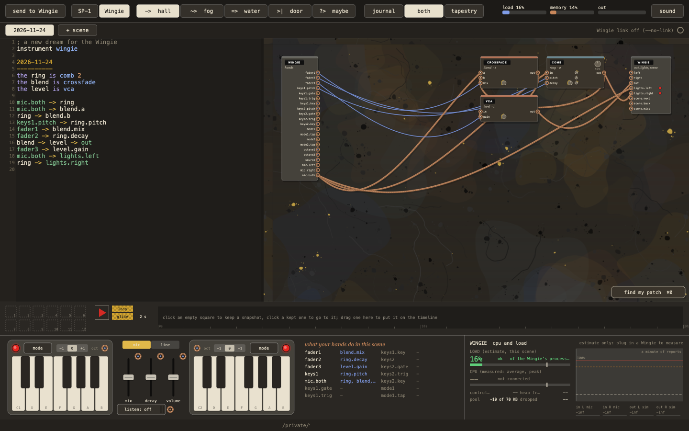
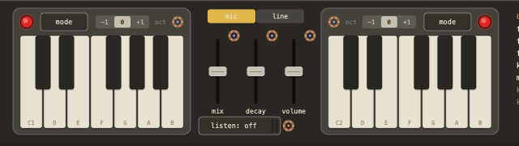
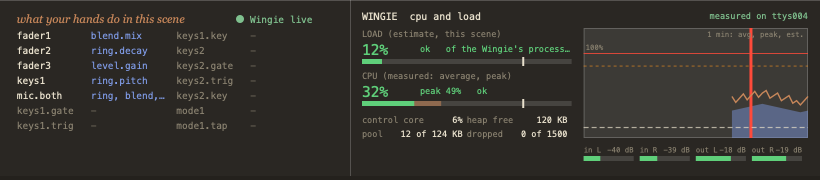
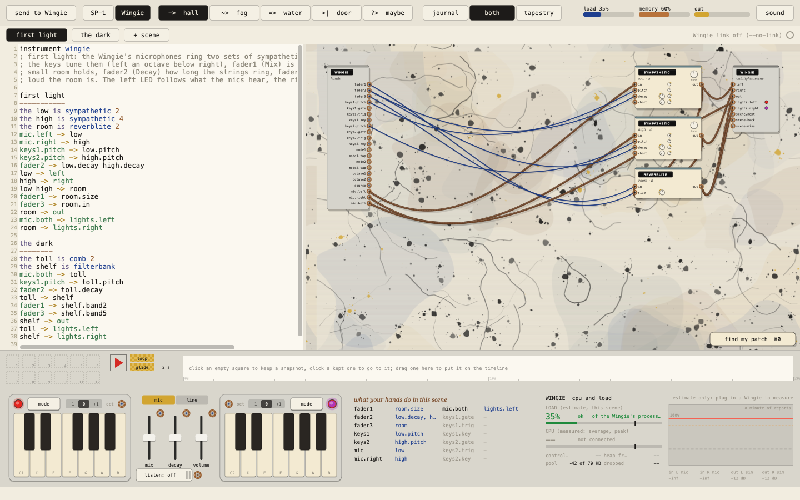
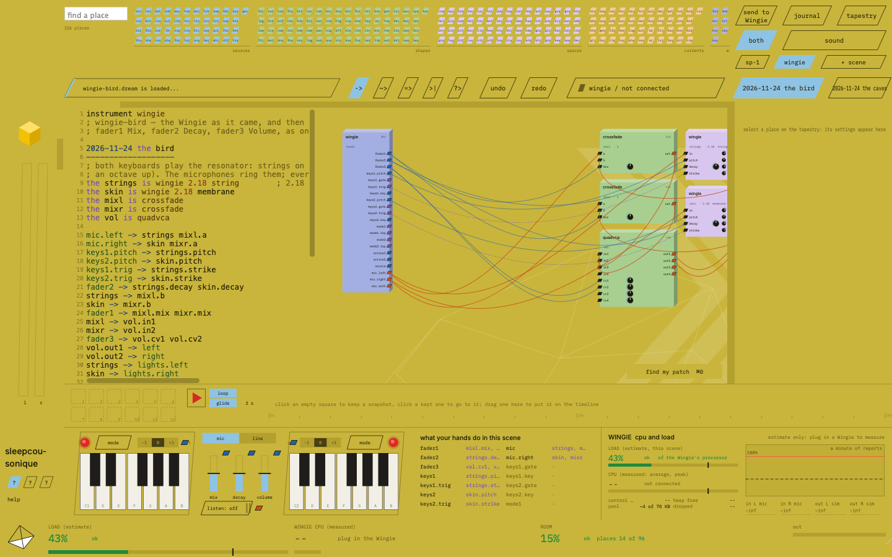

## 3. The editor in Wingie mode

The Sleepcousonique editor writes dreams for both instruments. A dream is for the SP-1
unless it says `instrument wingie`; the editor writes and removes that line for you.

### Switching to the Wingie

- **SP-1 | Wingie**, the switch in the top bar (in the faltung look: *sp-1* and *wingie* under
  the view buttons), says which instrument the open dream is for. Switching writes or removes the
  `instrument wingie` line. If the dream uses the other instrument's hands (`button1`, `rocker`,
  `fader4` on the Wingie; `keys1`, `mic` on the SP-1), the status line says how many lines to
  change, and the journal marks them.
- **File ▸ New dream for the Wingie** starts a fresh one: a comb rung by the microphones and
  tuned by the bottom keyboard, with Mix, Decay and Volume patched.
- **Device ▸ Patch for the SP-1 / Patch for the Wingie** does the same as the switch.

The place browser (right-click the tapestry, or the field of cells and *find a place* at the
top of the faltung look) lists only what the chosen instrument has. Type into **find a place**
to narrow it; Return places the first match. The hands that are always there (`fader`, `keys`,
`mode`, `octave`, `source`, `mic`) are used by their names and never placed: the browser says so
when you point at them.

### The Wingie's panel

Along the bottom, the editor draws the Wingie: the **bottom keyboard** on the left, the
**top keyboard** on the right (each with its **mode** button, its **−1 0 +1** octave switch and
its LED), and in the middle the **mic | line** switch and the three faders **mix**, **decay**
and **volume**.

| You | The Wingie |
|---|---|
| click a key, or type `z s x d c v g b h n j m` | bottom keyboard, C to B |
| type `q 2 w 3 e r 5 t 6 y 7 u` | top keyboard, C to B |
| type `a` / `p` | left / right Mode button |
| click −1, 0, +1 | the octave switches |
| click mic / line | the source switch |
| drag a fader | Mix, Decay, Volume (the status line shows its value) |

The computer keyboard plays the Wingie only while you aren't typing in the journal. The
editor has no slots, so the slot combination (both Mode buttons and a key) means nothing
there: `a` and `p` are just the two Mode buttons, seen by the dream.

**Patch from the panel.** Drag a fader, a keyboard or the microphones (the little loops beside
them) onto a place on the tapestry, and the hand is patched into it.

**The patch map**, *what your hands do in this scene*, lists every hand and where it goes in
the scene that is playing: `fader2 → ring.decay`, `keys1 → ring.pitch`, a dash for a hand the
scene doesn't use. It changes when the scene does.

**Wingie live.** When a Wingie with Sleepcousonique is plugged in, the panel follows it:
the keys you press, the faders, the switches, the scene and the slot all show on the screen,
and the dream in the editor follows the real one's scene.

### Listen: the computer's microphone as the Wingie's

`mic` is silent in the simulation until you **listen**: the **listen** button under the faders
(or **Device ▸ Listen to the computer's microphone as the Wingie's**) feeds the computer's
input into `mic.left`, `mic.right` and `mic.both`. **Sound settings…** chooses which input.
Wear headphones: a resonator listening to its own speaker feeds back, exactly as the real
Wingie does. Listening turns off by itself when the dream is for the SP-1.

### The meters

| Meter | What it says |
|---|---|
| **LOAD** (estimate, this scene) | the editor's estimate of the Wingie's processor for the scene that is playing, from costs measured on a real Wingie: *ok*, *tight* past 85 %, *too heavy* past 100 % |
| **CPU** (measured: average, peak) | what the Wingie itself reports every second, while one is connected |
| control core | the second core, which reads the panel (a few per cent) |
| heap free | the ESP32's free memory; red under 16 KB |
| pool | the engine's memory: what this scene uses of the pool (*est.* when it's the editor's estimate) |
| dropped | blocks of sound that were late in the last second, of how many; any at all is a stutter you hear |
| the graph | the last minute: the average filled, the peaks as a line, the estimate dashed, 85 % and 100 % marked, a mark for every second that dropped blocks |
| in L, in R, out L, out R | levels in dB: the Wingie's own when connected; the computer's microphone *(mic)* and the simulation *(sim)* when not |

Without a Wingie the top corner says *estimate only: plug in a Wingie to measure*; with one,
*measured on* and its port.

### Sending, and the twelve slots

- **send to Wingie** (top left), or **Device ▸ Send to Wingie (the slot that is playing)**,
  sends the dream into the slot that is playing, and it plays at once.
- **Device ▸ Send to Wingie slot ▸ slot 1 … slot 12** sends it into a chosen slot and plays it.
- The editor finds the Wingie on USB by itself. If the connected instrument is an SP-1 and the
  dream is for the Wingie (or the other way round), it says so instead of sending.
- Scales from the scales folder go along inside the dream as `tuning` lines (the Wingie has no
  files of its own).
- A slot keeps 16 KB of text; a longer dream is refused before it is sent.
- When a dream arrives, the Wingie's LEDs blink white. If it finds mistakes, the LEDs flicker
  fast and white, it keeps playing what it played before, and the editor shows the mistakes.
- If the Wingie has to go back to a lighter dream (chapter 4), the status line says so:
  *the Wingie: too heavy …*.

The status line at the top right says *wingie / connected*, with the slot and scene that are
playing.

