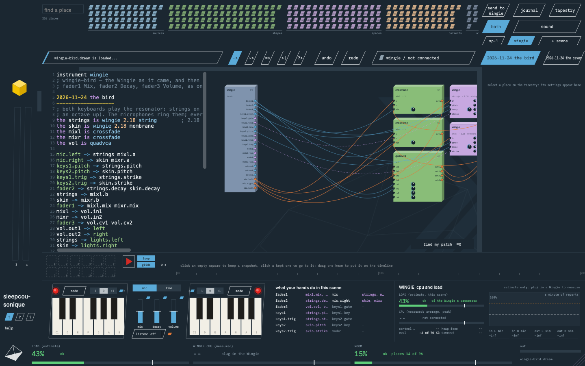

## 4. Writing a Wingie dream

Everything in the Sleepcousonique language guide holds on the Wingie: places, passages
(`->` hall, `~>` fog, `=>` water, `>|` door, `?>` maybe), natures, switches, knobs,
attenuverters, lucid groups, scenes and drift. This chapter is what's different.

### The first line

```dream
instrument wingie
; a comb rung by the room, tuned by the left keyboard

2026-11-24
----------
the ring is comb 2
mic.both -> ring -> out
keys1.pitch -> ring.pitch
fader2 -> ring.decay
```

`instrument wingie` can go anywhere, but the first line is where people look. Without it the
dream is for the SP-1, and `mic`, `keys1` and the rest are mistakes ("one of the Wingie's
hands: write `instrument wingie` at the top of the dream"). With it, the SP-1's hands
(`button1`–`button4`, `rocker`, `play`, `dots`, `leds`, `fader4`) are mistakes.

### The hands

The Wingie's hands are always there; use them by name, never `the x is keys`:

```dream
the chime is wingie 2.18 bar
the hush is vca
mic.both -> chime                ; the room rings it
keys1.pitch -> chime.pitch       ; the left keyboard tunes it
keys1.trig -> chime.strike       ; every key strikes it too
key13 -> hush.gain               ; the right keyboard's C opens it while held
mode1.tap -> chime.strike        ; a quick press of the left Mode button
octave2 ~> chime.decay           ; the right octave switch: longer or shorter
fader3 -> hush.gain
chime -> hush -> out
chime -> lights.left
mic.both -> lights.right
```



### Pitch units

A number can carry a unit wherever a pitch goes:

| written | means |
|---|---|
| `7st` | seven semitones |
| `-50ct` | fifty cents down |
| `1oct` | an octave |
| a bare number into a pitch inlet | octaves |
| a bare step in a `seq` | semitones, as always |

```dream
the a is wingie 2.18 string
the b is wingie 2.18 string tune=7st      ; a fifth above a
the c is wingie 2.18 string tune=-1oct
the walk is seq 4: 0 7st 1oct 350ct       ; 350 cents: a neutral third and a half
the tick is clock 1
tick -> walk.next
walk -> c.pitch
mic.left -> a b
mic.right -> c
a b c -> out
```

### Resolution: audio-rate control

Places read their pitch, cutoff and rates once a block (32 samples, 0.7 ms). For true
audio-rate FM into a resonator, ask the place to look closer:

```dream
the voice is sine 4 resolution=audio      ; every sample
the chime is wingie 2 resolution=fine     ; every 4 samples
voice -> chime.pitch
mic.both -> chime -> out
```

It costs that place's once-a-block work 8 (`fine`) or 32 (`audio`) times over (here the
resonator at `audio` would be too heavy; `fine` is plenty), and it only works at full rate:
with a lower `samplerate=` it is ignored, and the check warns. Use it where you hear the steps.

### Samplerate: half the rate, twice the tape

On the Wingie, **memory runs out before the processor does**. Every grain, time and spectral
place keeps a tape, and the tape's length is its nature in tenths of a second
(`grains 6` is 0.6 s, about 58 KB). The Wingie's pool is 70 KB a scene. `samplerate=half` keeps
the same number of samples at half the rate: **twice the seconds for the same memory**, and half
the work, a little darker:

```dream
the field is grains 3 samplerate=half     ; 0.6 s of tape in the memory of 0.3 s
the hall is reverblite 2
mic.both -> field
field field.right -> hall -> out
fader1 -> field.position
```

`samplerate=` takes `full` (48 kHz), `half`, `quarter` or `eighth` (6 kHz). Currents (LFOs,
envelopes, sequencers) lose nothing at `eighth`.

### Scenes

A line with dashes under it is a scene. Up to 16 in a dream. Every scene starts fresh: its own
places, its own memory (the 70 KB is per scene). On the Wingie:

- hold the **left Mode** button and tap the **right** for the next scene, the other way round
  for the previous;
- a dream can change scene itself: a pulse into `scene.next` or `scene.back`;
- `scene` and `slot` ignore pulses in the first 0.1 s of a scene (a clock pulses as it starts).

### The slot place: dreams that lead to dreams

`slot` goes to another dream on the Wingie:

```dream
the next is slot 7
the walk is slot
mode2.tap -> next.go          ; the right Mode button: slot 7
key24 -> walk.next            ; the right keyboard's B: the next slot
key23 -> walk.back            ; the right keyboard's A#: the one before
mic.both -> out
```

In the editor, which has no slots, the status line says what the Wingie would do.

### Too heavy: the last dream that fit

When a dream asks more of the processor than there is, the Wingie doesn't break up. When
four blocks are late within half a second, it goes back to what last played calmly for two
seconds:

1. the **previous scene**, if a heavy scene did it;
2. else **the dream that was playing before** (a dream that has only just arrived hasn't
   fitted yet);
3. else **first light**, which always fits.

The LEDs flash purple, and the editor's status line says which, as the Wingie reports it:
*the Wingie: too heavy for the Wingie: back to scene 2, the last that fit*. Before sending, the editor
asks first when its estimate is over 100 %. A scene whose memory doesn't fit at all never plays: the check
says *the house is full* before it is sent.
