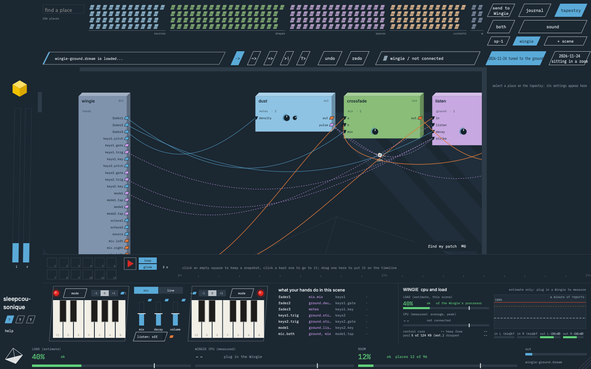

## 5. The places: the Wingie's own

Each place below has a heading, a line of what it dreams of, what it sounds like, its
inlets, outlets and switches as the engine lists them, its cost on the Wingie, and a tiny
dream. Every example was checked by `scqtool check` against the Wingie's 70 KB pool when this
manual was made; the grey line under it says what the check found. Add `instrument wingie` at
the top (the examples leave it out) and they play as they are.

These first places are the Wingie's own: its resonator and caves, and the instruments of its
family: Ciat-Lonbarde's Coco and Quantussy, Rollz, relabi, and the listening pieces it was made
for.



#### wingie — the Wingie2's resonator
*Dreamt: the instrument you're holding, opened up.*

Nine modes ringing on whatever comes in, with Meng Qi's own maths, anti-feedback guard and
input and output stage. `shape=` picks the stack: `string` and `bar` (the stock String and Bar
modes), `membrane`, `cave`, or `ratio` (each mode `ratio=` above the last). Decay 0 to 1 is 0.1
to 10 s; `strike` rings every mode at once; `odd` and `even` split the modes for stereo.

<!-- place wingie -->

```dream
the strings is wingie 2.18 string
mic.both -> strings
keys1.pitch -> strings.pitch
keys1.trig -> strings.strike
fader2 -> strings.decay
strings.odd -> left
strings.even -> right
```

#### cave — the three factory caves
*Dreamt: Low, Mid and High, the rooms under the Wingie.*

The stock Cave mode's three banks as one resonator: nature 1 Low, 2 Mid, 3 High. `shift`
moves the whole cave in octaves, so a keyboard into `shift` transposes the room.

<!-- place cave -->

```dream
the low is cave 1
mic.left -> low
keys1.pitch -> low.shift
mode1.tap -> low.strike
fader2 -> low.decay
low.odd -> left
low.even -> right
```

#### coco — an 8-bit delay whose clock is the time
*Dreamt: a cassette made of breadcrumbs.*

Peter Blasser's Coco: a delay where the clock rate *is* the time, so slower is longer, lower
and grainier. `freeze` holds the loop, `skip` jumps the head, `flip` turns it round; `verso` and
`inverso` are the output panned one way and the other.

<!-- place coco -->

```dream
the crumbs is coco 2
mic.both -> crumbs
fader1 -> crumbs.rate
fader2 -> crumbs.feedback
mode1 -> crumbs.freeze
mode2.tap -> crumbs.flip
crumbs.verso -> left
crumbs.inverso -> right
```

#### cocoquantus — two Cocos and a Quantussy
*Dreamt: BATH: two tapes in warm water, rocked by five petals.*

Two Cocos with a five-petal Quantussy inside that wobbles their clocks and swings their
verso and inverso across the stereo. `petals` is its speed; `auto=` lets the petals skip and
flip the tapes by themselves.

<!-- place cocoquantus -->

```dream
the bath is cocoquantus 0.5 auto=flip
mic.left -> bath
mic.right -> bath.right
fader1 -> bath.rate
fader2 -> bath.feedback
fader3 -> bath.petals
bath.left -> left
bath.right -> right
```

#### petals — the Quantussy
*Dreamt: five friends in a ring, never quite in step.*

Five triangle cores, each hurried or held back by its neighbours' signs: lurching, almost
periodic. Slow, it's four wobbling currents; `rate` climbs twelve octaves into a drone.

<!-- place petals -->

```dream
the ring is petals
the strings is wingie 2.18 string
mic.both -> strings -> out
ring.a ~> strings.pitch
ring.b -> strings.decay
fader1 -> ring.rate
```

#### relabi — almost a beat
*Dreamt: a pulse you can nearly dance to.*

John Berndt's relabi: four sines at irrational ratios, a pulse at each upward crossing of
their sum, `strength` how steep it was. A rhythm that keeps nearly arriving.

<!-- place relabi -->

```dream
the sway is relabi
the skin is wingie 3 membrane
sway.pulse -> skin.strike
sway.strength -> skin.decay
fader1 -> sway.rate
mic.both ~> skin
skin -> out
```

#### dust — random impulses
*Dreamt: specks of light in a sunbeam.*

SuperCollider's Dust: clicks of random height at random times, nature a second at density
0.5. A gentle way to strike resonators without a clock.

<!-- place dust -->

```dream
the motes is dust 4
the bar is wingie 4.36 bar
motes -> bar
fader1 -> motes.density
fader2 -> bar.decay
bar -> out
```

#### haze — a random value that glides
*Dreamt: the horizon moving when no one looks.*

On each trigger it glides to a new random value between `lo` and `hi`; left alone it moves
every nature seconds or so. Slow drift for anything.

<!-- place haze -->

```dream
the drift is haze 3
the strings is wingie 2.18 string
mic.both -> strings -> out
drift ~> strings.pitch
mode1.tap -> drift.trig
fader1 -> drift.glide
```

#### listen — tuned to the ground
*Dreamt: Thanks to the Ground Beneath My Feet.*

Hold `listen` and it listens; let go and it tunes its nine Wingie resonators to the nine
strongest resonances it heard, and `locked` pulses. Until then it rings the Low cave. Stand
somewhere, hold the button, and the room tunes the instrument.

<!-- place listen -->

```dream
the ground is listen
mic.both -> ground -> out
mode1 -> ground.listen
fader2 -> ground.decay
ground.locked -> lights.left
```

#### sittingroom — I am sitting in a room
*Dreamt: Alvin Lucier, generation after generation.*

What comes in is played into a room and recorded again, up to 32 passes, until only the
room's resonances are left. Nature is the room's size (1 is 5.2 × 4.1 × 2.7 m); the name you
give it picks its modes, so every room you name is a different room.

<!-- place sittingroom -->

```dream
the lucier is sittingroom
mic.both -> lucier -> out
fader1 -> lucier.generations
```

#### talkingdrum — a membrane that's squeezed
*Dreamt: the drummer's elbow under the strings.*

A membrane at nature × 60 Hz whose pitch is squeezed up to `depth` octaves: `mode=rise` climbs
with how loud the input is, `mode=fall` starts each stroke high and falls. `squeeze` squeezes it
by hand.

<!-- place talkingdrum -->

```dream
the drum is talkingdrum 2 fall
mic.both -> drum -> out
keys1.trig -> drum.strike
fader1 -> drum.squeeze
fader2 -> drum.decay
```

#### metastaseis — glissandi from chord to chord
*Dreamt: Xenakis's strings, straight lines of pitch.*

Nine single resonances gliding in straight lines from chord A (`chorda=`) to chord B
(`chordb=`) in nature seconds; `go` turns them round, `stagger` starts each a little after the
one below, `density` strikes them with dust. Feed it the room and it sings the room in glissandi.

<!-- place metastaseis -->

```dream
the xenakis is metastaseis 8 chorda=cluster chordb=harmonic
mic.both -> xenakis
mode1.tap -> xenakis.go
fader1 -> xenakis.stagger
fader3 -> xenakis.density
xenakis.l -> left
xenakis.r -> right
```

#### fourbit — Four Bit Modulo Phase Triplex
*Dreamt: three players reading the same 64 bits, drifting apart.*

A `capture` pulse takes 64 bits from the sign of what comes in; three loops of 64, 68 and 72
steps play them against each other, a pulse for every 1: the violin, the piano and the cello.

<!-- place fourbit -->

```dream
the score is fourbit
the violin is wingie 4.36 string
the cello is wingie 1.09 string
mic.both -> score
mode1.tap -> score.capture
score.violin -> violin.strike
score.cello -> cello.strike
violin -> left
cello -> right
```

#### knot — the Double Knot
*Dreamt: two voices tied by a shift register.*

After the Lorre Mill Double Knot: two triangle-to-square voices, each stepped by an 8-bit XOR
shift register (`lock` holds the loop), each with its envelope and VCA; `cross` lets them clock
each other.

<!-- place knot -->

```dream
the tie is knot
the beat is clock 4
beat -> tie.clock
fader1 -> tie.cross
mode1 -> tie.lock
keys1.pitch -> tie.pitch
tie.left -> left
tie.right -> right
```

#### benjolin — Rob Hordijk's Benjolin
*Dreamt: a small chaos that learns a tune.*

Two oscillators, a rungler shift register between them, a twin-peak filter on their
comparison. `chaos` is how far the rungler bends everything; `loop` locks the pattern.

<!-- place benjolin -->

```dream
the benji is benjolin
fader1 -> benji.chaos
fader2 -> benji.cutoff
mode1 -> benji.loop
keys1.pitch -> benji.pitch
benji -> out
```

#### rollz — the Rollz-5
*Dreamt: Pleasantly Drunk With Wings: a rhythm that rolls and lurches.*

Five pulse oscillators in a ring; each fire pulls its neighbours forward and pushes the far
ones back (`drama`), so the rhythm rolls instead of keeping a grid. Four lanes out.

<!-- place rollz -->

```dream
the wings is rollz 3
the skin is wingie 3 membrane
the strings is wingie 2.18 string
wings.a -> skin.strike
wings.c -> strings.strike
fader1 -> wings.drama
skin -> left
strings -> right
```

#### probee — four new random values
*Dreamt: a fortune-teller with four cards.*

After the Probee device: every trigger deals four new held random values; `width` narrows them
around 0.5; `spread=` picks their distribution.

<!-- place probee -->

```dream
the cards is probee gauss
the strings is wingie 2.18 string
keys1.trig -> cards.trig
cards.a -> strings.pitch
cards.b -> strings.decay
mic.both -> strings -> out
```
