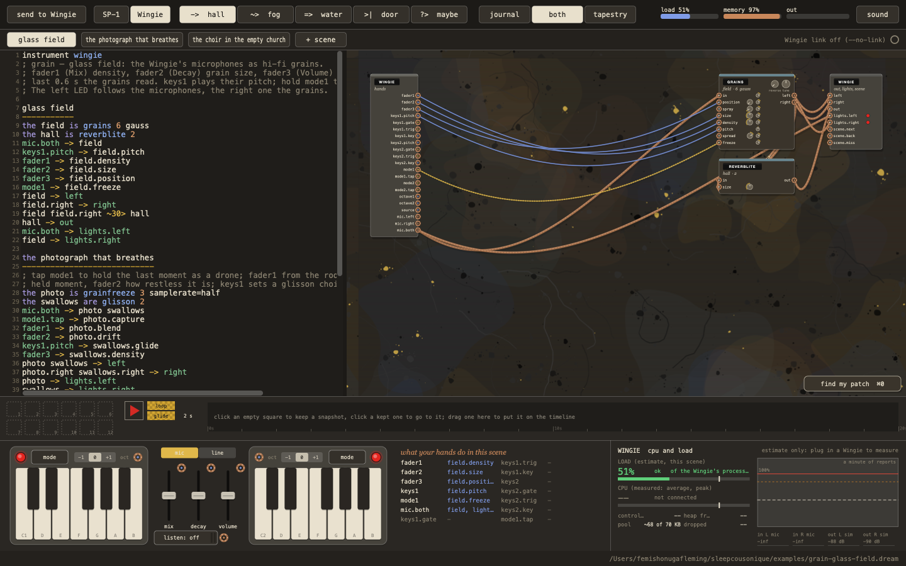

## 6. The places: hi-fi granular

Grains are small windows of sound, a few milliseconds to a second long, laid over each other.
These places are clean: Hermite reads, proper windows, octave-up grains read through a
half-band so they don't alias. Most keep a **tape** of what came in, and its length is the
**nature in tenths of a second** (6 is 0.6 s, about 58 KB). One big tape fits in a Wingie
scene; for two, give them shorter natures or `samplerate=half` (twice the seconds in the same
memory).



#### grains — the hi-fi granulator
*Dreamt: a field of glass beads catching the room.*

The classic: grains of what comes in, read from a moving `position` (0 now, 1 the tape's end),
`spray` scattering them further back, `size` 4 ms to 1 s, `density` a quarter to 24 grains deep,
`pitch` in octaves, `spread` across the stereo, `freeze` holding the tape. After Roads, Truax and
Granulator II.

<!-- place grains -->

```dream
the field is grains 6 gauss
mic.both -> field
fader1 -> field.density
fader2 -> field.size
fader3 -> field.position
keys1.pitch -> field.pitch
mode1 -> field.freeze
field -> left
field.right -> right
```

#### stretch — slow motion
*Dreamt: a slow-motion replay of the evening.*

WSOLA time-stretch: `speed` 1 is as it was, 0.1 ten times slower, 0 stands still, negative goes
backwards, and `pitch` (−2 to +1 octaves) moves on its own. A held note stays a clean note.

<!-- place stretch -->

```dream
the replay is stretch 6
mic.both -> replay -> out
fader1 -> replay.speed
mode1 -> replay.hold
```

#### paulstretch — one minute becomes one hour
*Dreamt: a glacier.*

Paul Nasca's extreme stretch: windows of 2048 (nature 1) or 4096 samples (nature 2) given random
phases, half over the next. `stretch` 0 to 1 is 1× to 1000×; `hold` stops time and lets the window
breathe. About 60 KB: alone in its scene. On the Wingie run it at `samplerate=half` (40 % of
the processor, against 71 % and the odd glitch at full rate).

<!-- place paulstretch -->

```dream
the glacier is paulstretch 2 samplerate=half
mic.both -> glacier -> out
fader1 -> glacier.stretch
mode1 -> glacier.hold
```

#### psola — the voice, moved
*Dreamt: a choir boy grown up overnight.*

Pitch-synchronous overlap-add: it tracks the period and lays two-period grains at the new one,
so `pitch` moves the voice and the formants stay (a voice stays a voice). `formant` moves them
on purpose; `period` is the tracked pitch, octaves from middle C.

<!-- place psola -->

```dream
the boy is psola
mic.both -> boy -> out
keys1.pitch -> boy.pitch
fader1 -> boy.formant
```

#### glisson — gliding grains
*Dreamt: swallows diving from the bridge.*

Curtis Roads' glissons: grains that glide in pitch as they sound. `glide` is the range in
octaves (negative falls), `spread` how many go the other way and how far they scatter.

<!-- place glisson -->

```dream
the swallows is glisson 4
mic.both -> swallows
fader1 -> swallows.glide
fader2 -> swallows.density
fader3 -> swallows.spread
swallows -> left
swallows.right -> right
```

#### grainfreeze — the photograph that breathes
*Dreamt: one moment, held, still moving.*

A pulse into `capture` holds the last moment as a seamless drone of overlapping grains; `drift`
wanders where they read (and up to half a semitone of pitch); `blend` from what comes in to what
is held. Clouds' freeze, done clean. Heavy at full rate on the Wingie (about 90 %): the example
runs it at `samplerate=half`.

<!-- place grainfreeze -->

```dream
the photo is grainfreeze 3 samplerate=half    ; 0.6 s of tape, half the memory and work
mic.both -> photo
mode1.tap -> photo.capture
fader1 -> photo.blend
fader2 -> photo.drift
photo -> left
photo.right -> right
```

#### graindelay — a corridor that sings back
*Dreamt: a mirrored corridor.*

A granular delay: grains read the line at `time` (10 ms to the tape) give or take `jitter`,
pitched in octaves, fed back through themselves. Pitch 1 and some feedback is a shimmer.

<!-- place graindelay -->

```dream
the corridor is graindelay 6
mic.both -> corridor
fader1 -> corridor.time
fader2 -> corridor.feedback
1oct -> corridor.pitch
corridor -> left
corridor.right -> right
```

#### scrub — a hand on the reel
*Dreamt: tape between the fingers.*

`record` catches a stretch of tape; then `position` moves the head across it, smoothed by
`smooth`. Slower than normal the grains keep their pitch, faster it rises like tape, stopped it
holds a grain loop.

<!-- place scrub -->

```dream
the reel is scrub 6
mic.both -> reel -> out
mode1 -> reel.record
fader1 -> reel.position
fader2 -> reel.smooth
```

#### wavesets — Trevor Wishart's waveset distortion
*Dreamt: a broken string of pearls, rethreaded.*

The sound cut at its rising zero crossings and each piece repeated, omitted, reversed, shuffled,
replaced by a sine, or averaged (`mode=`), `amount` how much. Voices turn to grit and
chant.

<!-- place wavesets -->

```dream
the pearls is wavesets repeat
mic.both -> pearls -> out
fader1 -> pearls.amount
```

#### harmonicgrains — a granular harmoniser
*Dreamt: the choir in the empty church.*

Grains of what comes in, transposed onto the tones of `chord=` on `pitch`, every tone with its own
place in the stereo.

<!-- place harmonicgrains -->

```dream
the choir is harmonicgrains 3 harmonic
mic.both -> choir
keys1.pitch -> choir.pitch
fader1 -> choir.density
choir -> left
choir.right -> right
```

#### beatgrains — tempo-locked stutters
*Dreamt: the DJ's hand on the platter.*

Every `clock` pulse fires a grain (or `burst=` of them) starting on one of the last 1–16 beats,
pitch stepping by `pattern=`. Unclocked it plays four a second.

<!-- place beatgrains -->

```dream
the platter is beatgrains 6 octaves
the beat is clock 4
mic.both -> platter
beat -> platter.clock
fader1 -> platter.slices
fader2 -> platter.length
platter -> left
platter.right -> right
```

#### granularverb — a reverb made of grains
*Dreamt: a cathedral of sand.*

Dozens of 10–35 ms grains reading a long delay at random times, fed back and gently darkened;
`size` is the reach and the decay, 0.5 to 16 s. At `samplerate=half` on the Wingie: it's
heavy at full rate.

<!-- place granularverb -->

```dream
the sand is granularverb 3 samplerate=half
mic.both -> sand
fader1 -> sand.size
fader2 -> sand.density
sand -> left
sand.right -> right
```

#### trainlet — FOF formant grains
*Dreamt: a voice from the radiator pipes.*

A source: at each period of `pitch` a grain at `formant` (200 Hz to 4 kHz) rings over
`bandwidth`; under full `density` the train comes in bursts. After Roads and Rodet's CHANT.

<!-- place trainlet -->

```dream
the pipes is trainlet
keys1.pitch -> pipes.pitch
fader1 -> pipes.formant
fader2 -> pipes.density
fader3 -> pipes.bandwidth
pipes -> out
```

#### gendy — dynamic stochastic synthesis
*Dreamt: the electric storm over Mycenae.*

Iannis Xenakis's GENDY: a wave of 12 breakpoints whose heights and lengths take random walks;
`amp_step` how far the heights wander, `dur_step` how far the lengths (and the pitch) do.

<!-- place gendy -->

```dream
the storm is gendy 2 cauchy
fader1 -> storm.amp_step
fader2 -> storm.dur_step
keys1.pitch -> storm.pitch
storm -> out
```

#### particles — a stochastic cloud
*Dreamt: dust in a projector beam.*

After Xenakis's screens: every grain's onset, pitch, length, place and moment drawn from
`dist=`; `screen` morphs from a tight shimmer to two octaves on a Xenakis sieve, half a second
back, wide, some reversed.

<!-- place particles -->

```dream
the beam is particles 4
mic.both -> beam
fader1 -> beam.screen
fader2 -> beam.density
beam -> left
beam.right -> right
```
