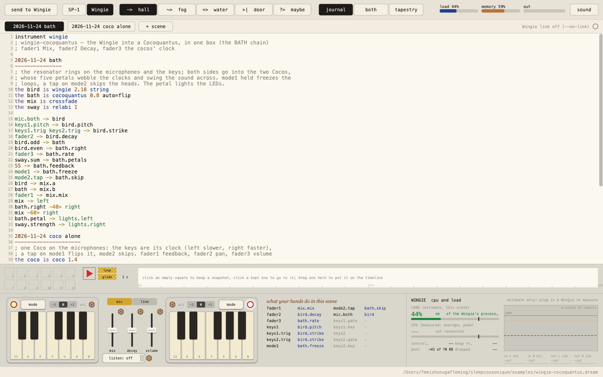

## 10. Recipes

Seven whole dreams, from the quiet to the loud. Each was checked scene by scene against the
Wingie's pool; the grey line gives every scene's memory and load. Copy one into the editor,
press **send to Wingie**, and change it. More are in `examples/` (`wingie-*`, `grain-*`,
`spectral-*`, `time-*`, `color-*`).



### Thanks to the ground beneath my feet

Stand somewhere. Hold the left Mode button while the place sounds, let go, and the Wingie is
tuned to it. The second scene plays the same ground into Lucier's room. Dust strikes the
resonators so the tuning rings even in silence.

```dream
instrument wingie
; thanks to the ground beneath my feet
; mode1 held: listen to the ground. Mix: how much dust. Decay: how long it rings. Volume: level

the ground
----------
the earth is listen
the motes is dust 2
the level is vca
the hand is limiter
mic.both -> earth
motes ~> earth
mode1 -> earth.listen
fader1 -> motes.density
fader2 -> earth.decay
fader3 -> level.gain
earth -> level -> hand -> out
earth.locked -> lights.left
mic.both -> lights.right

the room
--------
the lucier is sittingroom 2
the level is vca
mic.both -> lucier
fader1 -> lucier.generations
fader3 -> level.gain
lucier -> level -> out
lucier.room -> lights.left
```

### BATH

Two tapes in warm water. The microphones go into a Cocoquantus whose petals rock the tapes; the
left keyboard tunes strings under it, and a cavern holds everything. Scene two drains the
water: just the strings and the petals.

```dream
instrument wingie
; BATH
; Mix: tape speed. Decay: how long the water holds. Volume: the petals' speed
; mode1: freeze nothing, just strike the strings. keys1: tune them

bath
----
the water is cocoquantus 0.5 auto=flip
the strings is wingie 2.18 string
the under is cavern
mic.left -> water
mic.right -> water.right
mic.both ~> strings
keys1.pitch -> strings.pitch
mode1.tap -> strings.strike
fader1 -> water.rate
fader3 -> water.petals
fader2 -> under.size strings.decay
water.left strings.odd ~> under
water.left strings.odd -> left
water.right strings.even -> right
under.left -> left
under.right -> right
water.petal -> lights.left
strings -> lights.right

drained
-------
the ring is petals
the strings is wingie 2.18 string
mic.both -> strings
keys1.pitch -> strings.pitch
ring.a ~> strings.decay
ring.b -20> strings.pitch
fader3 -> ring.rate
fader2 -> strings.decay
strings.odd -> left
strings.even -> right
ring.c -> lights.left
```

### Pleasantly drunk with wings

A Rollz ring lurches through two membranes and a bar; the right Mode button throws it into the
dub echo. Scene two is the same rhythm, slower, through a Leslie.

```dream
instrument wingie
; pleasantly drunk with wings
; Mix: drama. Decay: ring. Volume: echo feedback. mode2 held: throw into the echo

wings
-----
the wings is rollz 3
the low is wingie 1.64 membrane
the high is wingie 3.27 membrane
the bar is wingie 2.18 bar
the send is dub
wings.a -> low.strike
wings.b -> high.strike
wings.d -> bar.strike
keys1.pitch -> bar.pitch
fader1 -> wings.drama
fader2 -> low.decay high.decay bar.decay
fader3 -> send.feedback
mode2 -> send.throw
mic.both ~> bar
low high bar -> send
send -> out
wings.a -> lights.left
wings.b -> lights.right

slower, in the cabinet
----------------------
the wings is rollz 1
the low is wingie 1.64 membrane
the bar is wingie 2.18 bar
the cabinet is rotary
wings.a -> low.strike
wings.c -> bar.strike
keys1.pitch -> bar.pitch
fader1 -> wings.drama
fader2 -> low.decay bar.decay
mode2 -> cabinet.fast
low bar -> cabinet
cabinet.left -> left
cabinet.right -> right
```

### Deep listening in the cistern

For long tones: sing, play, breathe into it. The Expanded Instrument System spins it around; the
left Mode button freezes the spectrum on top, and Mix lets the live sound seep into what is held.

```dream
instrument wingie
; deep listening in the cistern (after Pauline Oliveros)
; Mix: how much of the live sound seeps into the frozen chord. Decay: EIS feedback. Volume: EIS rate
; mode1 held: freeze

the cistern
-----------
the cistern is eis
the still is specfreeze
mic.both -> still
mode1 -> still.freeze
fader1 -> still.blend
still -> cistern
fader2 -> cistern.feedback
fader3 -> cistern.rate
cistern.left -> left
cistern.right -> right
still -> lights.left
cistern.left -> lights.right

the halo
--------
the halo is shimmer interval=7
mic.both -> halo
fader1 -> halo.shimmer
fader2 -> halo.size
halo.left -> left
halo.right -> right
```

### Mycenae at the bus stop

Xenakis by the roadside. GENDY storms on the left keyboard while particles scatter what the
microphones hear; scene two sends the room through Metastaseis glissandi.

```dream
instrument wingie
; mycenae at the bus stop
; Mix: the screen (shimmer to sieve). Decay: GENDY's wander. Volume: the storm's level

storm
-----
the storm is gendy 2 cauchy
the beam is particles 3 cauchy
the level is vca
mic.both -> beam
keys1.pitch -> storm.pitch
fader1 -> beam.screen
fader2 -> storm.amp_step storm.dur_step
fader3 -> level.gain
storm -> level
level beam -> left
level beam.right -> right
storm -> lights.left
beam -> lights.right

glissandi
---------
the strings is metastaseis 12 chorda=cluster chordb=fifths cycle=on
mic.both -> strings
fader1 -> strings.stagger
fader3 -> strings.density
mode1.tap -> strings.go
strings.l -> left
strings.r -> right
strings.pos -> lights.left
```

### Under the bridge

A clap under a bridge becomes the room. Tap the left Mode button, clap, and the convolver plays
inside what came back, with the bass kept low and heavy for a sound system. The convolver's room
takes most of a scene's memory, so the dub echo lives in the next scene: hold the left Mode button
and tap the right to go there.

```dream
instrument wingie
; under the bridge
; scene 1: mode1 captures the next clap as the room. Mix: room. Volume: sub
; scene 2: mode2 held throws into the echo. Mix: time. Decay: feedback. Volume: tone

2026-11-24 under the bridge
---------------------------
the bridge is convolve
the floor is bassman
mic.both -> bridge
mode1.tap -> bridge.capture
fader1 -> bridge.mix
bridge -> floor -> out
fader3 -> floor.sub
bridge -> lights.left
floor.sub -> lights.right

2026-11-24 the echo off the water
---------------------------------
the send is dub
the floor is bassman
mic.both -> send
mode2 -> send.throw
fader1 -> send.time
fader2 -> send.feedback
fader3 -> send.tone
send -> floor -> out
send.wet -> lights.left
floor.sub -> lights.right
```

### Four bit, three players, twelve slots

Four Bit Modulo Phase Triplex on three Wingie resonators: the left Mode button captures 64 bits from
the room, and the three loops drift apart. The right keyboard's B asks the Wingie for the next slot: a dream
that leads to the next one.

```dream
instrument wingie
; four bit modulo phase triplex for violin, piano and cello
; mode1: capture 64 bits from the room. Decay: ring. Volume: level. right B: the next slot

triplex
-------
the score is fourbit
the violin is wingie 4.36 string
the piano is wingie 2.75 bar
the cello is wingie 1.09 string
the level is quadvca
the onward is slot
mic.both -> score
mode1.tap -> score.capture
score.violin -> violin.strike
score.piano -> piano.strike
score.cello -> cello.strike
fader2 -> violin.decay piano.decay cello.decay
violin -> level.in1
cello -> level.in2
piano -> level.in3
fader3 -> level.cv1 level.cv2 level.cv3
level.out1 level.out3 -> left
level.out2 level.out3 -> right
key24 -> onward.next
score.all -> lights.left
```
